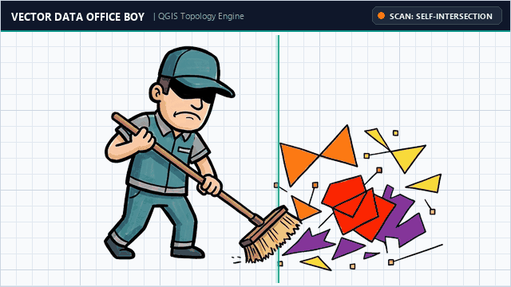
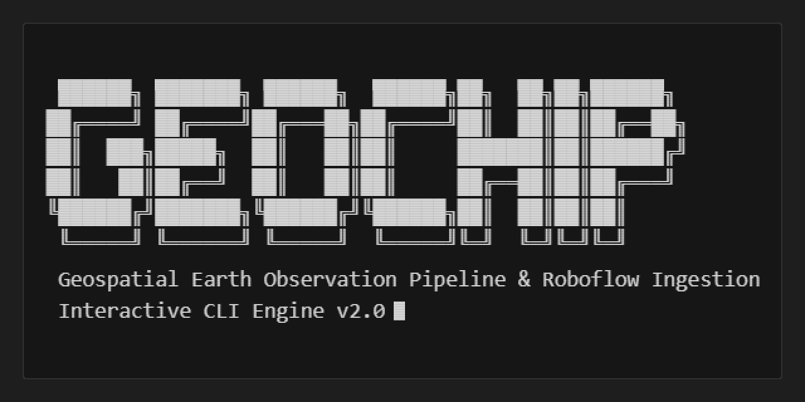
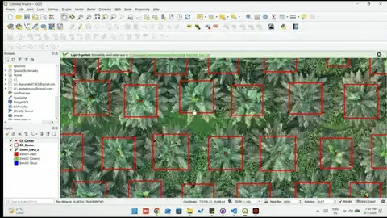
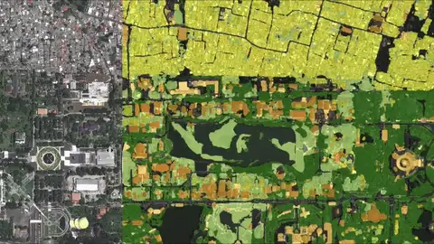

# Bayu Nabiil

**Geospatial Data & ML Engineer · GeoAI, Remote Sensing & Production GIS Tooling**

I design and ship production-grade geospatial automation systems that bridge **Deep Learning**, **Earth Observation**, and **Desktop GIS**. My work focuses on containerized computer vision pipelines for satellite and UAV imagery, multi-sensor data ingestion workflows, and zero-conflict QGIS plugins backed by automated testing and reproducible provenance.

---

## Core Engineering Focus

| Domain | Scope & Engineering Practice |
|---|---|
| **GeoAI & Computer Vision** | Object detection and semantic segmentation on UAV orthophotos and 30 cm VHR satellite imagery using PyTorch, YOLOv8, SegFormer, DeepLabV3+, U-Net, and SAHI. |
| **Earth Observation Pipelines** | Multi-sensor satellite acquisition, cloud masking, server-side compositing, and georeferenced chipping with Google Earth Engine, GDAL, Rasterio, and Roboflow. |
| **Production GIS & MLOps** | Dependency-isolated QGIS plugins (Qt5/Qt6 & Docker backends), deterministic vector topology QA/QC, CI/CD pipelines, and SHA-256 execution provenance. |

---

## Featured Projects

<table width="100%">
<tr>
<td width="50%" valign="top">
<b><a href="https://github.com/Anovvy/vector-data-office-boy">Vector Data Office Boy</a></b> 
<code>QGIS 3.22+ / Qt6</code> · <code>PyQGIS</code> · <code>Shapely / GEOS</code> · <code>Processing Provider</code>  
All-in-one QGIS plugin (<code>v1.0.3</code>) for automated 4-stage polygon topology auditing and in-place geometry cleaning across spatial planning (RTRW) and land-cover datasets. Detects and repairs ring self-intersections, overlaps, internal gaps (strictly preserving outer boundaries), and slivers with automatic UTM metric normalization, atomic overwrite, 8 Processing algorithms, and zero external dependencies.
  

</td>
<td width="50%" valign="top">
<b><a href="https://github.com/Anovvy/GeoChip">GeoChip</a></b> 
<code>Python</code> · <code>Docker</code> · <code>Google Earth Engine</code> · <code>Rasterio</code> · <code>Roboflow</code>  
Interactive CLI (<code>v2.0</code>) and containerized pipeline for multi-satellite Earth Observation ingestion (Sentinel-2 L2A, Landsat 8/9, Sentinel-1 SAR, MODIS, NASA SRTM DEM). Supports date and cloud-cover filtering, server-side GEE compositing (Median, Q25, Mean, Min-Cloud), single-raster chipping (160–1280 px) with WGS84 <code>manifest.json</code>, and automated Roboflow Annotation Batch uploads.
  

</td>
</tr>
<tr>
<td width="50%" valign="top">
<b><a href="https://github.com/Anovvy/PalmAI_Plugin">PalmAI - QGIS Plugin</a></b> 
<code>QGIS 3.x</code> · <code>Docker</code> · <code>PyTorch</code> · <code>YOLOv8</code> · <code>DeepLabV3+</code> · <code>GHCR</code>  
Decoupled QGIS plugin (<code>v2.0.0</code>) powered by an isolated Docker/Virtualenv backend with automatic CUDA-to-CPU fallback for oil palm UAV imagery. Automates tree counting, crown centroid localization, 3-class health classification, and canopy-resistant road vectorization (skeletonization &amp; A* pathfinding), backed by SHA-256 verified weights, 34 automated tests, and CI/CD.
  

</td>
<td width="50%" valign="top">
<b><a href="https://github.com/Anovvy/vhr-satellite-segmentation-pipeline">VHR Satellite Segmentation Pipeline</a></b> 
<code>Docker</code> · <code>PyTorch</code> · <code>SegFormer</code> · <code>U-Net</code> · <code>DeepLabV3+</code> · <code>GDAL</code>  
100% containerized deep-learning pipeline for urban land-cover segmentation from 30 cm VHR RGB satellite imagery. Benchmarks SegFormer (MiT-B0, 71.2% OA / 56.0% mIoU), U-Net (ResNet34), and DeepLabV3+ (ResNet50) via 512×512 sliding-window Gaussian blending, generating georeferenced GeoTIFFs, polygonized GeoPackages, confusion matrices, 29 tests, and SHA-256 provenance manifests.
  

</td>
</tr>
</table>

---

## Additional Tools & Portfolio

| Project | Description | Stack |
|---|---|---|
| **[ArcMap LULC Keyshortcuts](https://github.com/Anovvy/ArcMap-LULC-Keyshortcuts)** | Ergonomic desktop GIS workflow toolkit bringing OpenStreetMap iD Editor home-row shortcuts (`W-A-S-D`, `1-3`, `Space`) to ArcMap 10.x wall-to-wall LULC Cut & Merge digitizing. | `Python Add-In`, `AutoHotkey v2`, `ArcMap 10.x` |
| **[Interactive Portfolio](https://my-portfolio-olive-ten-24.vercel.app)** | Web portfolio showcasing GeoAI deployments, mapping consultancy experience, and spatial engineering projects. | `JavaScript`, `HTML/CSS`, `Vercel` |

---

## Tech Stack

| Category | Technologies |
|---|---|
| **Languages** |     |
| **Deep Learning & CV** |         |
| **Geospatial & EO** |        |
| **Containers, CI/CD & QA** |       |

---

Open to collaborations on **GeoAI**, **Remote Sensing Automation**, and **Open-Source GIS Tooling**.

[Portfolio](https://my-portfolio-olive-ten-24.vercel.app) · [LinkedIn](https://www.linkedin.com/in/bayunabiil) · [Email](mailto:bayunabiil1365@gmail.com)

